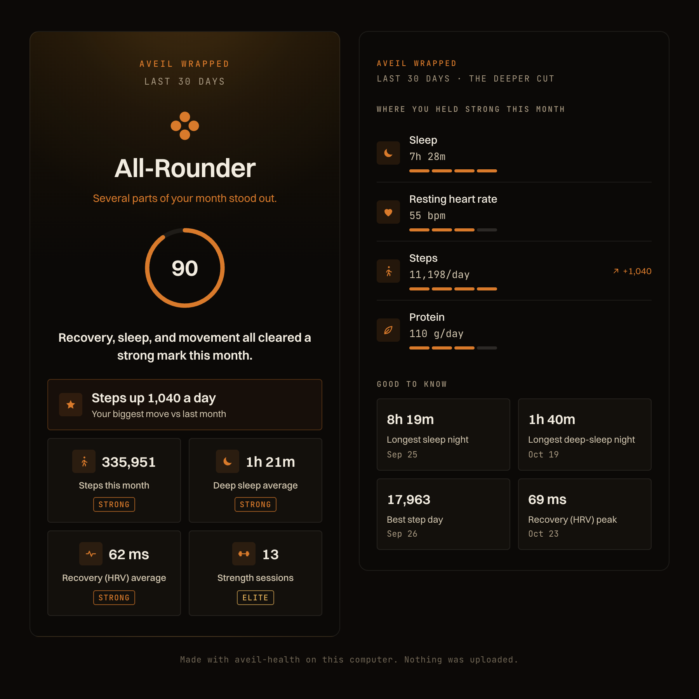
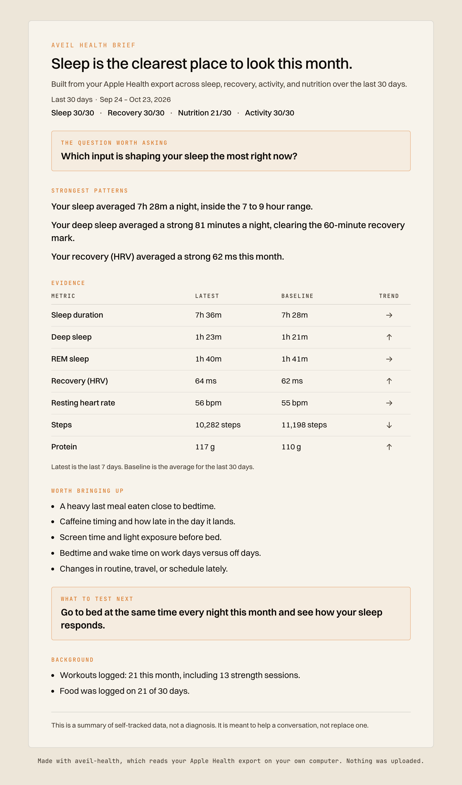

# aveil-health

Your Apple Health data, read on your own computer: a shareable Wrapped card, a health brief for your next appointment, and a plain report.

This is the early open-source tool that the Aveil app grew from. Get Aveil on the [App Store](https://apps.apple.com/us/app/aveil-health/id6761336522) or [Google Play](https://play.google.com/store/apps/details?id=com.aveil.app).

```bash
npx aveil-health wrapped export.zip
```

Everything runs on your machine. Your export is never uploaded.

## Aveil Wrapped

A recap card in the Aveil app's design: your standout for the period, a simple score, and the facts behind it.

```bash
npx aveil-health wrapped export.zip                  # last 30 days
npx aveil-health wrapped export.zip --period week
npx aveil-health wrapped export.zip --period year
```

<p align="center">
  
</p>

## Health brief

A calm, printable one-page summary to bring to a doctor or coach. It names the clearest area to look at, the question worth asking, your averages next to your last 7 days, and what to bring up.

```bash
npx aveil-health brief export.zip
npx aveil-health brief export.zip --output ~/Desktop/health-brief.html
npx aveil-health sleep-brief export.zip              # sleep and recovery only
```

<p align="center">
  
</p>

The brief is a summary of self-tracked data, not a diagnosis.

Both images above come from `npx aveil-health demo`, which makes every output from a synthetic export. No real person's data is in this repo.

## Get started

### 1. Export your Apple Health data

On your iPhone:

1. Open the **Health** app.
2. Tap your **profile picture** (top right).
3. Tap **Export All Health Data**, then **Export**. It takes a minute.
4. AirDrop or save the `.zip` to your computer.

The file can be hundreds of megabytes. That's fine: the tool reads it in a stream and never loads it all into memory. Use the `.zip` as it is, or the `export.xml` inside it.

### 2. Run it

```bash
npx aveil-health wrapped export.zip                  # Wrapped card
npx aveil-health brief export.zip                    # health brief
npx aveil-health analyze export.zip                  # report in the terminal
npx aveil-health analyze export.zip --days 14 --json > report.json
npx aveil-health demo                                # try it without your own data
```

No install, no account, no config. Add `--open` to open the card or brief in your browser.

## How the card and brief work out the numbers

Everything is a simple, standard measure, so you can check it yourself:

- **Averages** over the period you choose: by default the last 30 complete days before your export (the export day itself is left out).
- **Latest vs baseline** in the brief: your last 7 days next to the period average. Arrows show a change of more than 3%.
- **This period vs the one before** on the Wrapped card, shown only when the change is big enough to matter (for example 10 minutes of deep sleep or 1,000 steps a day).
- **Sleep stages** from your watch, one main sleep per day. Naps are left out.
- **Common reference marks**, such as 7 to 9 hours of sleep, 60 minutes of deep sleep, and 7,000 steps a day. Tags on the card are fixed marks too: 8,000 steps a day is Strong and 15,000 is Elite.
- **One comparison with other people:** the Wrapped card can say *Top ~10% recovery, among people your age*. It places your average HRV (or resting heart rate) from at least 10 days on published age-based norms, rounds to top ~5%, ~10%, or ~25%, and shows nothing unless you are in the top quarter. It needs your date of birth in Apple Health.
- **The score** is the plain average of up to three parts: sleep (4 to 8 hours), steps (0 to 10,000 a day), and resting heart rate (80 down to 50 bpm). It shows only when at least two parts have 5 or more days of data.

When a watch and a phone count the same minutes, those steps count once, and the phone still counts the hours the watch was off.

The `analyze` report and the MCP tools use their own older rules (14-night averages and a weighted readiness score).

## MCP server

Give your AI assistant a local view of your health data. Add this to your MCP config (Claude Code, Cursor, Codex, and others):

```json
{
  "mcpServers": {
    "aveil-health": {
      "command": "npx",
      "args": ["aveil-health", "mcp"],
      "env": {
        "AVEIL_HEALTH_EXPORT": "/path/to/your/export.zip"
      }
    }
  }
}
```

Then ask things like *"How did I sleep last night?"* or *"How is my recovery trending?"*

Tools: `analyze_health`, `get_sleep_summary`, `get_recovery_status`, `get_activity_summary`, `get_signals`, `get_recommendations`.

## Privacy

- **Local:** your export is read and analyzed on your computer.
- **Never uploaded:** no account, no analytics, no server. The only network request is for two web fonts when you open a card or brief, and it carries none of your data.
- **Open source:** read every line, fork it, make it yours.

## Use it as a library

```js
import { parseHealthExport, buildPeriodSummary, generateWrappedHTML } from "aveil-health";

const data = await parseHealthExport("export.zip", { days: 62 });
const summary = buildPeriodSummary(data, { days: 30 });
const { html } = generateWrappedHTML(summary);
```

## Requirements

- Node.js 18 or later
- An Apple Health export (an Apple Watch adds sleep stages, HRV, and resting heart rate)

## License

MIT

---

Built by [@alexalexxss](https://github.com/alexalexxss) · [aveilx.com](https://aveilx.com)
